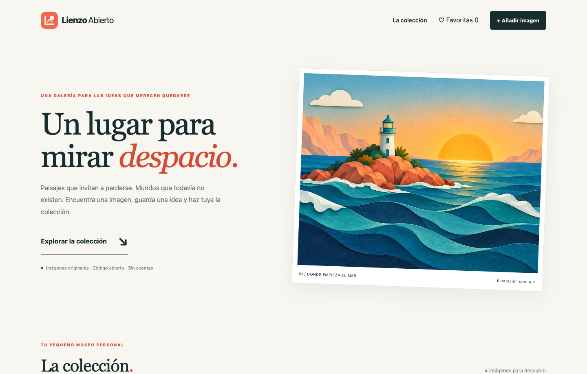

<p align="center"><strong>Lienzo Abierto</strong><br>Una galería para mirar despacio.</p>

# Lienzo Abierto

Galería de imágenes con búsqueda, categorías, favoritos y colección personal en el navegador.

[](LICENSE) [](https://github.com/davidcantonnadales/lienzo-abierto/actions/workflows/checks.yml)



## Qué puedes hacer

- Cuatro ilustraciones originales incluidas, de temática familiar.
- Filtro, búsqueda, orden y vista ampliada con teclado.
- Favoritos persistentes y descarga.
- Importación JPG/PNG/WebP con validación, reducción y guardado en IndexedDB. Máximo 20 imágenes locales.
- Sin cuentas, anuncios, claves API ni subida de archivos a servidores.

## Arrancar en tu equipo

Recomendado: **Node.js 22.13 o posterior de la rama 22**, con npm. `.nvmrc` selecciona Node 22. Las pruebas iniciales locales se ejecutaron con Node 23.10.0; CI utiliza Node 22. Las aplicaciones con SQLite usan `node:sqlite`, que puede mostrar un aviso experimental según la versión.

```bash
npm ci
npm run dev
```

Abre **http://127.0.0.1:3000**. Para comprobar una compilación de producción:

```bash
npm test
npm run build
npm start
```

## Una prueba de cinco minutos

Explora una categoría, guarda una favorita y recarga. Después añade `public/art/faro.webp` desde el formulario, abre la imagen y elimínala. La importación no hace una petición de subida.

## Qué incluye esta edición

Los favoritos y las imágenes añadidas pertenecen al navegador y origen actuales. Borrar sus datos elimina la colección; descarga los originales que quieras conservar. No es una plataforma multiusuario ni sincroniza dispositivos.

Esta es una edición pública independiente y adaptada para aprender y desarrollar sobre ella. No incluye datos, credenciales, dominios privados ni infraestructura de la instalación de origen. No pretende reproducir todos los módulos de esa instalación.

## Documentación y pruebas

- [Cómo está organizado y cómo configurarlo](docs/CONFIGURACION.md).
- [Pruebas realizadas y límites](docs/PRUEBAS.md).
- [Procedencia de imágenes y capturas](docs/IMAGENES.md).
- [Seguridad y datos](SECURITY.md).


## Contribuir

Abre una issue con los pasos para reproducir el problema, el resultado esperado y la versión de Node/navegador. Para proponer un cambio, crea una rama, comprueba `npm test` y `npm run build`, y abre una pull request. No adjuntes datos personales, documentos de clientes, claves o archivos `.env`.

## Licencia

Código y documentación bajo [MIT](LICENSE). Las ilustraciones de ejemplo, cuando las hay, se generaron con IA para este proyecto y se distribuyen bajo los mismos términos en la medida en que existan derechos aplicables; no se garantiza exclusividad. Las dependencias conservan sus licencias. No se incluyen marcas ni recursos de terceros para sugerir patrocinio.

Creado por [David Cantón](https://davidcanton.net).
